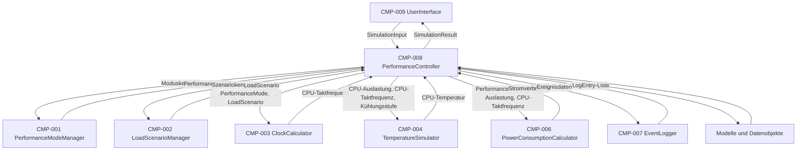

# Iteration 2 – Software Architektur

## 1. Zweck dieses Dokuments

Dieses Dokument beschreibt die Software-Architektur für Iteration 2 des Laptop-Prozessorleistungsmoduls.

Die Datei konkretisiert die bestehende Architektur aus Iteration 1 für den zweiten lauffähigen Entwicklungsstand. In Iteration 2 wird die Grundsimulation erweitert um:

* Auswahl einer Kühlungsstufe,
* Berechnung einer simulierten CPU-Temperatur,
* Berechnung eines simulierten Stromverbrauchs,
* einfache Ereignisprotokollierung für Moduswechsel, Lastszenario-Wechsel und Temperaturwarnungen,
* erweiterte Ausgabe des Simulationsergebnisses.

Nicht Bestandteil dieser Architekturversion ist das vollständige Thermal Throttling. Die Throttling-Stufen und die effektive Reduzierung der CPU-Taktfrequenz werden erst in Iteration 3 vollständig umgesetzt.

---

## 2. Ausgangspunkt aus Iteration 1

Iteration 1 stellt bereits eine lauffähige Grundsimulation bereit.

Aktiv umgesetzt wurden:

| Teilfunktionalität | Beschreibung                                     | Status    |
| ------------------ | ------------------------------------------------ | --------- |
| TF-01              | Leistungsmodus mit benutzerdefiniertem Modus     | umgesetzt |
| TF-02              | Vordefinierte Lastszenarien                      | umgesetzt |
| TF-03              | Taktberechnung abhängig von Modus und Auslastung | umgesetzt |

Die vorhandene Architektur besteht aus:

```text
Benutzerschnittstelle
        ↓
Anwendungssteuerung
        ↓
Fachlogik / Services
        ↓
Modelle und Datenobjekte
```

Diese Schichtenarchitektur wird in Iteration 2 beibehalten und erweitert.

---

## 3. Architekturziel der Iteration 2

Das Ziel der Architektur in Iteration 2 ist eine kontrollierte Erweiterung der bestehenden Grundsimulation.

Die Architektur muss ermöglichen, dass:

* bestehende Funktionen aus Iteration 1 unverändert weiter nutzbar bleiben,
* der Nutzer zusätzlich eine Kühlungsstufe auswählen kann,
* die Temperaturberechnung in einer eigenen Komponente gekapselt wird,
* die Stromverbrauchsberechnung in einer eigenen Komponente gekapselt wird,
* einfache Ereignisse in einer eigenen Komponente erfasst werden,
* die Ergebnisdaten strukturiert erweitert werden,
* Thermal Throttling in Iteration 3 ohne grundlegende Umstrukturierung ergänzt werden kann.

---

## 4. Architekturabgrenzung der Iteration 2

### 4.1 Bestandteil der Iteration 2

| Bereich           | Bestandteil                                                                           |
| ----------------- | ------------------------------------------------------------------------------------- |
| Eingabe           | Leistungsmodus, Lastszenario, Kühlungsstufe                                           |
| Berechnung        | CPU-Auslastung, ungedrosselte CPU-Taktfrequenz, CPU-Temperatur, Stromverbrauch        |
| Ausgabe           | CPU-Auslastung, CPU-Taktfrequenz, CPU-Temperatur, Stromverbrauch, einfache Ereignisse |
| Ereignisprotokoll | Moduswechsel, Lastszenario-Wechsel, Temperaturwarnung                                 |
| Qualität          | Regression der Iteration-1-Funktionen, Testbarkeit, Ausgabe mit Einheiten             |

### 4.2 Nicht Bestandteil der Iteration 2

| Bereich                                               | Begründung                                         |
| ----------------------------------------------------- | -------------------------------------------------- |
| Mehrstufiges Thermal Throttling                       | Wird erst in Iteration 3 umgesetzt.                |
| Reduzierte effektive CPU-Taktfrequenz                 | Benötigt Thermal Throttling aus Iteration 3.       |
| Ereignisse für aktiviertes oder geändertes Throttling | Werden erst mit vollständigem Throttling relevant. |
| Vollständige Reset-Logik des Ereignisprotokolls       | Wird in Iteration 3 ergänzt.                       |

---

## 5. Aktive Komponenten in Iteration 2

### 5.1 Weiterverwendete Komponenten aus Iteration 1

| Komponenten-ID | Komponente               | Schicht               | Aufgabe in Iteration 2                                        |
| -------------- | ------------------------ | --------------------- | ------------------------------------------------------------- |
| CMP-009        | `UserInterface`          | Benutzerschnittstelle | Nimmt Eingaben entgegen und zeigt das erweiterte Ergebnis an. |
| CMP-008        | `PerformanceController`  | Anwendungssteuerung   | Koordiniert den erweiterten Simulationsablauf.                |
| CMP-001        | `PerformanceModeManager` | Fachlogik / Services  | Stellt Leistungsmodi bereit und validiert die Auswahl.        |
| CMP-002        | `LoadScenarioManager`    | Fachlogik / Services  | Stellt Lastszenarien bereit und validiert die Auswahl.        |
| CMP-003        | `ClockCalculator`        | Fachlogik / Services  | Berechnet die ungedrosselte CPU-Taktfrequenz.                 |

### 5.2 Neue oder aktivierte Komponenten in Iteration 2

| Komponenten-ID | Komponente                   | Schicht                           | Aufgabe in Iteration 2                                                                            |
| -------------- | ---------------------------- | --------------------------------- | ------------------------------------------------------------------------------------------------- |
| CMP-004        | `TemperatureSimulator`       | Fachlogik / Services              | Berechnet die simulierte CPU-Temperatur aus CPU-Auslastung, CPU-Taktfrequenz und Kühlungsstufe.   |
| CMP-006        | `PowerConsumptionCalculator` | Fachlogik / Services              | Berechnet den simulierten Stromverbrauch aus Leistungsmodus, CPU-Auslastung und CPU-Taktfrequenz. |
| CMP-007        | `EventLogger`                | Protokollierung / Nachweisführung | Erfasst einfache Ereignisse während des Simulationslaufs.                                         |

---

## 6. Noch nicht aktive oder nur vorbereitete Komponenten

| Komponenten-ID | Komponente                    | Geplante Iteration | Status in Iteration 2                                                                                   |
| -------------- | ----------------------------- | -----------------: | ------------------------------------------------------------------------------------------------------- |
| CMP-005        | `ThermalThrottlingController` |                  3 | Noch nicht aktiv.                                                                                       |
| CMP-007        | `EventLogger`                 |                2–3 | In Iteration 2 nur einfache Ereignisprotokollierung; vollständige Protokollierung folgt in Iteration 3. |

Der `ThermalThrottlingController` wird bewusst noch nicht in den aktiven Berechnungsablauf aufgenommen. Dadurch bleibt die Taktfrequenz in Iteration 2 ungedrosselt.

Für Iteration 2 gilt:

```text
effektive CPU-Taktfrequenz = ungedrosselte CPU-Taktfrequenz
```

Die spätere Abweichung zwischen ungedrosselter und effektiver CPU-Taktfrequenz wird in Iteration 3 ergänzt.

---

## 7. Architekturübersicht



---

## 8. Datenfluss in Iteration 2

Der Datenfluss der Iteration 2 erweitert den linearen Ablauf aus Iteration 1.

1. `UserInterface` zeigt verfügbare Leistungsmodi an.
2. Nutzer wählt einen Leistungsmodus.
3. `UserInterface` zeigt verfügbare Lastszenarien an.
4. Nutzer wählt ein Lastszenario.
5. `UserInterface` zeigt verfügbare Kühlungsstufen an.
6. Nutzer wählt eine Kühlungsstufe.
7. `UserInterface` erstellt ein `SimulationInput`-Objekt.
8. `PerformanceController` erhält das `SimulationInput`-Objekt.
9. `PerformanceController` ruft den `PerformanceModeManager` auf.
10. `PerformanceModeManager` liefert ein `PerformanceMode`-Objekt.
11. `PerformanceController` ruft den `LoadScenarioManager` auf.
12. `LoadScenarioManager` liefert ein `LoadScenario`-Objekt.
13. `PerformanceController` erstellt oder aktualisiert einen `ProcessorState`.
14. `PerformanceController` ruft den `ClockCalculator` auf.
15. `ClockCalculator` berechnet die ungedrosselte CPU-Taktfrequenz.
16. `PerformanceController` ruft den `TemperatureSimulator` auf.
17. `TemperatureSimulator` berechnet die CPU-Temperatur.
18. `PerformanceController` ruft den `PowerConsumptionCalculator` auf.
19. `PowerConsumptionCalculator` berechnet den Stromverbrauch.
20. `PerformanceController` übergibt relevante Ereignisse an den `EventLogger`.
21. `EventLogger` erstellt Ereignisprotokolleinträge.
22. `PerformanceController` erstellt ein erweitertes `SimulationResult`.
23. `UserInterface` zeigt das erweiterte Simulationsergebnis an.

---

## 9. Schnittstellen in Iteration 2

| Schnittstellen-ID | Von                     | Nach                          | Übergabe                                            | Rückgabe                                     | Status                        |
| ----------------- | ----------------------- | ----------------------------- | --------------------------------------------------- | -------------------------------------------- | ----------------------------- |
| IF-001            | `UserInterface`         | `PerformanceController`       | `SimulationInput`                                   | `SimulationResult`                           | erweitert                     |
| IF-002            | `PerformanceController` | `PerformanceModeManager`      | Moduskennung / `SimulationInput`                    | `PerformanceMode`                            | unverändert                   |
| IF-003            | `PerformanceController` | `LoadScenarioManager`         | Szenariokennung                                     | `LoadScenario`                               | unverändert                   |
| IF-004            | `PerformanceController` | `ClockCalculator`             | `PerformanceMode`, `LoadScenario`                   | CPU-Taktfrequenz in GHz                      | unverändert                   |
| IF-005            | `PerformanceController` | `TemperatureSimulator`        | CPU-Auslastung, CPU-Taktfrequenz, Kühlungsstufe     | CPU-Temperatur in °C                         | neu aktiv                     |
| IF-006            | `PerformanceController` | `ThermalThrottlingController` | CPU-Temperatur, CPU-Taktfrequenz                    | Throttling-Stufe, effektive CPU-Taktfrequenz | vorbereitet, noch nicht aktiv |
| IF-007            | `PerformanceController` | `PowerConsumptionCalculator`  | `PerformanceMode`, CPU-Auslastung, CPU-Taktfrequenz | Stromverbrauch in W                          | neu aktiv                     |
| IF-008            | `PerformanceController` | `EventLogger`                 | Ereignisdaten                                       | Ereignisprotokolleintrag / Ereignisliste     | neu aktiv                     |
| IF-009            | `PerformanceController` | `UserInterface`               | `SimulationResult`                                  | Anzeige im Konsoleninterface                 | erweitert                     |

---

## 10. Datenmodelle in Iteration 2

### 10.1 Weiterverwendete Datenmodelle

| Datenmodell        | Zweck                                                 | Änderung in Iteration 2                                   |
| ------------------ | ----------------------------------------------------- | --------------------------------------------------------- |
| `SimulationInput`  | Bündelt die Nutzereingaben für einen Simulationslauf. | Erweiterung um Kühlungsstufe.                             |
| `PerformanceMode`  | Beschreibt einen Leistungsmodus.                      | Keine grundlegende Änderung.                              |
| `LoadScenario`     | Beschreibt ein Lastszenario mit CPU-Auslastung.       | Keine grundlegende Änderung.                              |
| `ProcessorState`   | Speichert den aktuellen Prozessorzustand.             | Erweiterung um CPU-Temperatur und Stromverbrauch.         |
| `SimulationResult` | Bündelt die finalen Ergebniswerte.                    | Erweiterung um Temperatur, Stromverbrauch und Ereignisse. |

### 10.2 Neue Datenmodelle

| Datenmodell    | Zweck                                                                                                             |
| -------------- | ----------------------------------------------------------------------------------------------------------------- |
| `CoolingLevel` | Beschreibt eine auswählbare Kühlungsstufe mit Kennung, Anzeigename und Kühlungsfaktor.                            |
| `LogEntry`     | Beschreibt einen Ereignisprotokolleintrag mit Ereigniszeitpunkt, Ereignistyp, Beschreibung und Simulationswerten. |

---

## 11. Verantwortlichkeiten der Komponenten

### 11.1 `UserInterface`

Das `UserInterface` bleibt die äußere Benutzerschnittstelle der Anwendung.

Aufgaben in Iteration 2:

* Leistungsmodi anzeigen,
* Lastszenarien anzeigen,
* Kühlungsstufen anzeigen,
* Nutzereingaben entgegennehmen,
* `SimulationInput` erstellen,
* erweitertes `SimulationResult` anzeigen,
* Fehlermeldungen kontrolliert ausgeben.

Das `UserInterface` berechnet keine Simulationswerte.

---

### 11.2 `PerformanceController`

Der `PerformanceController` bleibt die zentrale Ablaufsteuerung.

Aufgaben in Iteration 2:

* Eingaben validiert an Fachkomponenten weiterreichen,
* Leistungsmodus bestimmen,
* Lastszenario bestimmen,
* ungedrosselte CPU-Taktfrequenz berechnen lassen,
* CPU-Temperatur berechnen lassen,
* Stromverbrauch berechnen lassen,
* einfache Ereignisse erfassen lassen,
* Ergebnisobjekt erzeugen.

Der `PerformanceController` koordiniert die Berechnung, führt aber keine fachliche Berechnungslogik selbst aus.

---

### 11.3 `TemperatureSimulator`

Der `TemperatureSimulator` ist für die Temperaturberechnung zuständig.

Aufgaben:

* CPU-Auslastung übernehmen,
* CPU-Taktfrequenz übernehmen,
* Kühlungsstufe berücksichtigen,
* CPU-Temperatur im Bereich von 35 °C bis 100 °C bestimmen,
* Temperaturwert an den `PerformanceController` zurückgeben.

Die Temperaturberechnung bleibt deterministisch. Gleiche Eingaben erzeugen gleiche Temperaturwerte.

---

### 11.4 `PowerConsumptionCalculator`

Der `PowerConsumptionCalculator` ist für die Stromverbrauchsberechnung zuständig.

Aufgaben:

* Leistungsmodus übernehmen,
* CPU-Auslastung übernehmen,
* CPU-Taktfrequenz übernehmen,
* Stromverbrauch im Bereich von 8 W bis 65 W bestimmen,
* Stromverbrauch an den `PerformanceController` zurückgeben.

In Iteration 2 wird die ungedrosselte CPU-Taktfrequenz als effektive CPU-Taktfrequenz verwendet, da Thermal Throttling noch nicht aktiv ist.

---

### 11.5 `EventLogger`

Der `EventLogger` ist für die einfache Ereignisprotokollierung zuständig.

Aufgaben in Iteration 2:

* Moduswechsel als Ereignis erfassen,
* Lastszenario-Wechsel als Ereignis erfassen,
* Temperaturwarnung ab mindestens 70 °C erfassen,
* Ereignisse als `LogEntry` speichern,
* Ereignisliste für das Ergebnis bereitstellen.

In Iteration 2 werden noch keine Ereignisse für aktiviertes oder geändertes Thermal Throttling erzeugt.

---

## 12. Ereignisprotokollierung in Iteration 2

In Iteration 2 werden nur einfache Ereignisse unterstützt.

| Ereignistyp                | Auslöser                                                      | Iteration-2-Status |
| -------------------------- | ------------------------------------------------------------- | ------------------ |
| `MODUSWECHSEL`             | Aktueller Leistungsmodus wurde geändert.                      | aktiv              |
| `LASTSZENARIOWECHSEL`      | Aktuelles Lastszenario wurde geändert.                        | aktiv              |
| `TEMPERATURWARNUNG`        | CPU-Temperatur beträgt mindestens 70 °C.                      | aktiv              |
| `THROTTLING_AKTIVIERT`     | Throttling-Stufe `Reduziert` oder `Kritisch` erreicht.        | nicht aktiv        |
| `THROTTLING_GEÄNDERT`      | Throttling-Stufe wurde gegenüber vorherigem Zustand geändert. | nicht aktiv        |
| `SIMULATION_ZURÜCKGESETZT` | Simulationslauf wurde zurückgesetzt.                          | nicht aktiv        |

Ein `LogEntry` enthält in Iteration 2 bereits die vorgesehenen Felder. Felder, die erst durch Thermal Throttling vollständig entstehen, werden in Iteration 2 nur vorbereitet.

---

## 13. Umgang mit effektiver CPU-Taktfrequenz

Das Pflichtenheft unterscheidet zwischen ungedrosselter und effektiver CPU-Taktfrequenz.

In Iteration 2 ist Thermal Throttling noch nicht aktiv. Deshalb gilt:

```text
Ungedrosselte CPU-Taktfrequenz = Effektive CPU-Taktfrequenz
```

Diese Entscheidung ist eine Architekturvorbereitung für Iteration 3.

In Iteration 3 wird der `ThermalThrottlingController` zwischen Temperaturberechnung und Stromverbrauchsberechnung eingefügt. Dann kann sich die effektive CPU-Taktfrequenz von der ungedrosselten CPU-Taktfrequenz unterscheiden.

---

## 14. Qualitätsanforderungen in Iteration 2

| Requirement                         | Bedeutung für die Architektur                                                    |
| ----------------------------------- | -------------------------------------------------------------------------------- |
| REQ-NF-001 Determinismus            | Alle Berechnungen bleiben formelbasiert und reproduzierbar.                      |
| REQ-NF-002 Testbarkeit              | Fachlogik bleibt in separaten Serviceklassen testbar.                            |
| REQ-NF-003 Robustheit               | Ungültige Eingaben werden kontrolliert behandelt.                                |
| REQ-NF-004 Konfigurationsmanagement | Iteration 2 wird als eigene Baseline versioniert.                                |
| REQ-NF-005 Performance              | Die Berechnung bleibt einfach und muss innerhalb von 5 Sekunden ausführbar sein. |
| REQ-NF-006 Ausgabequalität          | Numerische Werte werden mit Einheit ausgegeben.                                  |

---

## 15. Architekturentscheidung für Iteration 2

### ADR-I2-001 – Thermal Throttling wird noch nicht aktiv geschaltet

**Entscheidung:**
Thermal Throttling wird in Iteration 2 nicht aktiv in den Simulationsablauf aufgenommen.

**Begründung:**
Iteration 2 soll zuerst Temperaturberechnung, Stromverbrauch und einfache Ereignisprotokollierung stabil einführen. Thermal Throttling baut fachlich auf der Temperaturberechnung auf und wird deshalb in Iteration 3 umgesetzt.

**Konsequenz:**
In Iteration 2 entspricht die effektive CPU-Taktfrequenz der ungedrosselten CPU-Taktfrequenz.

---

### ADR-I2-002 – Temperatur- und Stromverbrauchsberechnung werden getrennt

**Entscheidung:**
Temperaturberechnung und Stromverbrauchsberechnung werden in zwei separaten Servicekomponenten umgesetzt.

**Begründung:**
Die beiden Berechnungen besitzen unterschiedliche fachliche Verantwortlichkeiten. Eine Trennung verbessert Testbarkeit, Verständlichkeit und spätere Erweiterbarkeit.

**Konsequenz:**
Es entstehen die Komponenten `TemperatureSimulator` und `PowerConsumptionCalculator`.

---

### ADR-I2-003 – Ereignisprotokollierung wird als eigene Komponente eingeführt

**Entscheidung:**
Die Ereignisprotokollierung wird nicht im `PerformanceController` umgesetzt, sondern in der Komponente `EventLogger`.

**Begründung:**
Der `PerformanceController` soll den Ablauf koordinieren, aber keine eigene Protokollierungslogik enthalten.

**Konsequenz:**
Ereignisse werden über eine eigene Schnittstelle an den `EventLogger` übergeben.

---

## 16. Vorbereitung für Iteration 3

Die Architektur der Iteration 2 bereitet Iteration 3 vor.

In Iteration 3 sollen ergänzt werden:

* `ThermalThrottlingController`,
* Ermittlung der Throttling-Stufe,
* Berechnung der effektiven CPU-Taktfrequenz,
* Neuberechnung des Stromverbrauchs nach Throttling,
* Ereignisse für aktiviertes und geändertes Throttling,
* vollständige Ausgabe des Ereignisprotokolls,
* Zurücksetzen eines Simulationslaufs.

Der geplante spätere Ablauf lautet:

```text
ClockCalculator
        ↓
TemperatureSimulator
        ↓
ThermalThrottlingController
        ↓
PowerConsumptionCalculator
        ↓
EventLogger
```

In Iteration 2 wird dieser Ablauf vorbereitet, aber noch nicht vollständig umgesetzt.