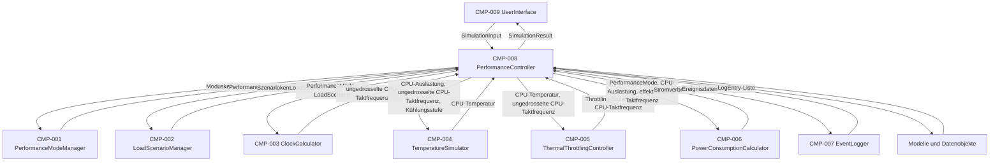

# Iteration 3 – Software Architektur

## 1. Zweck dieses Dokuments

Dieses Dokument beschreibt die Software-Architektur für Iteration 3 des Laptop-Prozessorleistungsmoduls.

Die Datei konkretisiert die bestehende Architektur aus Iteration 2 für den dritten und finalen lauffähigen Entwicklungsstand. In Iteration 3 wird die bisherige Simulation erweitert um:

* mehrstufiges Thermal Throttling,
* Bestimmung der Throttling-Stufe,
* Berechnung der effektiven CPU-Taktfrequenz,
* Neuberechnung des Stromverbrauchs auf Basis der effektiven CPU-Taktfrequenz,
* vollständige Ereignisprotokollierung für Throttling-Ereignisse,
* chronologische Ausgabe des Ereignisprotokolls,
* Reset-Funktion für den Simulationslauf.

---

## 2. Ausgangspunkt aus Iteration 2

Iteration 2 stellt bereits eine lauffähige erweiterte Simulation bereit.

Aktiv umgesetzt wurden:

| Teilfunktionalität | Beschreibung                                     | Status nach Iteration 2 |
| ------------------ | ------------------------------------------------ | ----------------------- |
| TF-01              | Leistungsmodus mit benutzerdefiniertem Modus     | umgesetzt               |
| TF-02              | Vordefinierte Lastszenarien                      | umgesetzt               |
| TF-03              | Taktberechnung abhängig von Modus und Auslastung | umgesetzt               |
| TF-04              | Temperaturberechnung mit Kühlungsstufe           | umgesetzt               |
| TF-06              | Stromverbrauch in Watt ableiten                  | umgesetzt               |
| TF-07              | einfache Ereignisprotokollierung                 | teilweise umgesetzt     |

Die vorhandene Architektur besteht weiterhin aus:

```text
Benutzerschnittstelle
        ↓
Anwendungssteuerung
        ↓
Fachlogik / Services
        ↓
Modelle und Datenobjekte
        ↓
Protokollierung / Nachweisführung
```

In Iteration 2 war Thermal Throttling noch nicht aktiv. Für Iteration 2 galt:

```text
effektive CPU-Taktfrequenz = ungedrosselte CPU-Taktfrequenz
```

Diese Einschränkung wird in Iteration 3 aufgehoben.

---

## 3. Architekturziel der Iteration 3

Das Ziel der Architektur in Iteration 3 ist die Fertigstellung der vollständigen Simulationskette.

Die Architektur muss ermöglichen, dass:

* bestehende Funktionen aus Iteration 1 und 2 unverändert weiter nutzbar bleiben,
* aus der CPU-Temperatur eine Throttling-Stufe bestimmt wird,
* die effektive CPU-Taktfrequenz aus der Throttling-Stufe berechnet wird,
* die ungedrosselte und die effektive CPU-Taktfrequenz getrennt gespeichert werden,
* der Stromverbrauch nach Anwendung von Thermal Throttling neu bestimmt wird,
* Throttling-Ereignisse protokolliert werden,
* das Ereignisprotokoll chronologisch bereitgestellt wird,
* ein Simulationslauf kontrolliert zurückgesetzt werden kann,
* alle neuen Funktionen testbar und tracebar bleiben.

---

## 4. Architekturabgrenzung der Iteration 3

### 4.1 Bestandteil der Iteration 3

| Bereich           | Bestandteil                                                                                                                  |
| ----------------- | ---------------------------------------------------------------------------------------------------------------------------- |
| Eingabe           | Leistungsmodus, Lastszenario, Kühlungsstufe                                                                                  |
| Berechnung        | CPU-Auslastung, ungedrosselte CPU-Taktfrequenz, CPU-Temperatur, Throttling-Stufe, effektive CPU-Taktfrequenz, Stromverbrauch |
| Throttling        | Stufen `Normal`, `Warnung`, `Reduziert`, `Kritisch`                                                                          |
| Ausgabe           | CPU-Auslastung, ungedrosselte CPU-Taktfrequenz, effektive CPU-Taktfrequenz, CPU-Temperatur, Throttling-Stufe, Stromverbrauch |
| Ereignisprotokoll | Moduswechsel, Lastszenario-Wechsel, Temperaturwarnung, Throttling aktiviert, Throttling geändert, Simulation zurückgesetzt   |
| Qualität          | Regression der Funktionen aus Iteration 1 und 2, Testbarkeit, Ausgabe mit Einheiten, Traceability                            |

### 4.2 Nicht Bestandteil der Iteration 3

| Bereich                          | Begründung                                                                  |
| -------------------------------- | --------------------------------------------------------------------------- |
| Reale CPU-Steuerung              | Das System simuliert Werte und verändert keine reale Hardware.              |
| Reales Auslesen von Sensorwerten | CPU-Temperatur, Takt und Stromverbrauch werden softwaretechnisch berechnet. |
| Betriebssystem-Energieprofile    | Das System greift nicht auf echte Betriebssystemprofile zu.                 |
| Benchmark-Vergleich              | Benchmarks sind nicht Bestandteil des definierten Projektumfangs.           |
| System- oder Abnahmetest         | Für die Projektarbeit ist kein System- bzw. Abnahmetest erforderlich.       |

---

## 5. Aktive Komponenten in Iteration 3

### 5.1 Weiterverwendete Komponenten aus Iteration 1 und 2

| Komponenten-ID | Komponente                   | Schicht                           | Aufgabe in Iteration 3                                                     |
| -------------- | ---------------------------- | --------------------------------- | -------------------------------------------------------------------------- |
| CMP-009        | `UserInterface`              | Benutzerschnittstelle             | Nimmt Eingaben entgegen und zeigt das vollständige Simulationsergebnis an. |
| CMP-008        | `PerformanceController`      | Anwendungssteuerung               | Koordiniert den vollständigen Simulationsablauf.                           |
| CMP-001        | `PerformanceModeManager`     | Fachlogik / Services              | Stellt Leistungsmodi bereit und validiert die Auswahl.                     |
| CMP-002        | `LoadScenarioManager`        | Fachlogik / Services              | Stellt Lastszenarien bereit und validiert die Auswahl.                     |
| CMP-003        | `ClockCalculator`            | Fachlogik / Services              | Berechnet die ungedrosselte CPU-Taktfrequenz.                              |
| CMP-004        | `TemperatureSimulator`       | Fachlogik / Services              | Berechnet die simulierte CPU-Temperatur.                                   |
| CMP-006        | `PowerConsumptionCalculator` | Fachlogik / Services              | Berechnet den Stromverbrauch auf Basis der effektiven CPU-Taktfrequenz.    |
| CMP-007        | `EventLogger`                | Protokollierung / Nachweisführung | Erfasst einfache Ereignisse, Throttling-Ereignisse und Reset-Ereignisse.   |

### 5.2 Neue oder vollständig aktivierte Komponenten in Iteration 3

| Komponenten-ID | Komponente                    | Schicht              | Aufgabe in Iteration 3                                                      |
| -------------- | ----------------------------- | -------------------- | --------------------------------------------------------------------------- |
| CMP-005        | `ThermalThrottlingController` | Fachlogik / Services | Bestimmt die Throttling-Stufe und berechnet die effektive CPU-Taktfrequenz. |

---

## 6. Architekturübersicht



---

## 7. Datenfluss in Iteration 3

Der Datenfluss der Iteration 3 erweitert den Ablauf aus Iteration 2 um Thermal Throttling und die anschließende Neuberechnung des Stromverbrauchs.

1. `UserInterface` zeigt verfügbare Leistungsmodi an.
2. Nutzer wählt einen Leistungsmodus.
3. `UserInterface` zeigt verfügbare Lastszenarien an.
4. Nutzer wählt ein Lastszenario.
5. `UserInterface` zeigt verfügbare Kühlungsstufen an.
6. Nutzer wählt eine Kühlungsstufe.
7. `UserInterface` erstellt ein `SimulationInput`-Objekt.
8. `PerformanceController` erhält das `SimulationInput`-Objekt.
9. `PerformanceController` ruft den `PerformanceModeManager` auf.
10. `PerformanceModeManager` liefert ein `PerformanceMode`-Objekt.
11. `PerformanceController` ruft den `LoadScenarioManager` auf.
12. `LoadScenarioManager` liefert ein `LoadScenario`-Objekt.
13. `PerformanceController` erstellt oder aktualisiert einen `ProcessorState`.
14. `PerformanceController` ruft den `ClockCalculator` auf.
15. `ClockCalculator` berechnet die ungedrosselte CPU-Taktfrequenz.
16. `PerformanceController` speichert die ungedrosselte CPU-Taktfrequenz im `ProcessorState`.
17. `PerformanceController` ruft den `TemperatureSimulator` auf.
18. `TemperatureSimulator` berechnet die CPU-Temperatur.
19. `PerformanceController` speichert die CPU-Temperatur im `ProcessorState`.
20. `PerformanceController` ruft den `ThermalThrottlingController` auf.
21. `ThermalThrottlingController` bestimmt die Throttling-Stufe.
22. `ThermalThrottlingController` berechnet die effektive CPU-Taktfrequenz.
23. `PerformanceController` speichert Throttling-Stufe und effektive CPU-Taktfrequenz im `ProcessorState`.
24. `PerformanceController` ruft den `PowerConsumptionCalculator` auf.
25. `PowerConsumptionCalculator` berechnet den Stromverbrauch auf Basis der effektiven CPU-Taktfrequenz.
26. `PerformanceController` speichert den Stromverbrauch im `ProcessorState`.
27. `PerformanceController` übergibt relevante Ereignisse an den `EventLogger`.
28. `EventLogger` erstellt Ereignisprotokolleinträge.
29. `PerformanceController` erstellt ein vollständiges `SimulationResult`.
30. `UserInterface` zeigt das vollständige Simulationsergebnis an.
31. `UserInterface` zeigt das Ereignisprotokoll chronologisch an.

---

## 8. Schnittstellen in Iteration 3

| Schnittstellen-ID | Von                     | Nach                          | Übergabe                                                      | Rückgabe                                     | Status            |
| ----------------- | ----------------------- | ----------------------------- | ------------------------------------------------------------- | -------------------------------------------- | ----------------- |
| IF-001            | `UserInterface`         | `PerformanceController`       | `SimulationInput`                                             | `SimulationResult`                           | weiterhin aktiv   |
| IF-002            | `PerformanceController` | `PerformanceModeManager`      | Moduskennung / `SimulationInput`                              | `PerformanceMode`                            | unverändert       |
| IF-003            | `PerformanceController` | `LoadScenarioManager`         | Szenariokennung                                               | `LoadScenario`                               | unverändert       |
| IF-004            | `PerformanceController` | `ClockCalculator`             | `PerformanceMode`, `LoadScenario`                             | ungedrosselte CPU-Taktfrequenz in GHz        | unverändert       |
| IF-005            | `PerformanceController` | `TemperatureSimulator`        | CPU-Auslastung, ungedrosselte CPU-Taktfrequenz, Kühlungsstufe | CPU-Temperatur in °C                         | unverändert aktiv |
| IF-006            | `PerformanceController` | `ThermalThrottlingController` | CPU-Temperatur, ungedrosselte CPU-Taktfrequenz                | Throttling-Stufe, effektive CPU-Taktfrequenz | neu aktiv         |
| IF-007            | `PerformanceController` | `PowerConsumptionCalculator`  | `PerformanceMode`, CPU-Auslastung, effektive CPU-Taktfrequenz | Stromverbrauch in W                          | erweitert         |
| IF-008            | `PerformanceController` | `EventLogger`                 | Ereignisdaten, Throttling-Stufe, Reset-Ereignis               | Ereignisprotokolleintrag / Ereignisliste     | erweitert         |
| IF-009            | `PerformanceController` | `UserInterface`               | `SimulationResult`                                            | Anzeige im Konsoleninterface                 | erweitert         |

---

## 9. Datenmodelle in Iteration 3

### 9.1 Weiterverwendete Datenmodelle

| Datenmodell        | Zweck                                                 | Änderung in Iteration 3                                                                  |
| ------------------ | ----------------------------------------------------- | ---------------------------------------------------------------------------------------- |
| `SimulationInput`  | Bündelt die Nutzereingaben für einen Simulationslauf. | Keine grundlegende Änderung.                                                             |
| `PerformanceMode`  | Beschreibt einen Leistungsmodus.                      | Keine grundlegende Änderung.                                                             |
| `LoadScenario`     | Beschreibt ein Lastszenario mit CPU-Auslastung.       | Keine grundlegende Änderung.                                                             |
| `CoolingLevel`     | Beschreibt eine auswählbare Kühlungsstufe.            | Keine grundlegende Änderung.                                                             |
| `ProcessorState`   | Speichert den aktuellen Prozessorzustand.             | Erweiterung um effektive CPU-Taktfrequenz und Throttling-Stufe.                          |
| `SimulationResult` | Bündelt die finalen Ergebniswerte.                    | Erweiterung um Throttling-Stufe, effektive CPU-Taktfrequenz und vollständige Ereignisse. |
| `LogEntry`         | Beschreibt einen Ereignisprotokolleintrag.            | Nutzung für Throttling- und Reset-Ereignisse.                                            |

### 9.2 Neues optionales Datenmodell

| Datenmodell       | Zweck                                                                                        |
| ----------------- | -------------------------------------------------------------------------------------------- |
| `ThrottlingState` | Beschreibt eine Throttling-Stufe mit Kennung, Anzeigename, Temperaturbereich und Taktfaktor. |

Das Datenmodell `ThrottlingState` kann als Klasse oder als `enum` umgesetzt werden. Für die Architektur ist entscheidend, dass die Throttling-Stufe eindeutig im `ProcessorState`, im `SimulationResult` und im `LogEntry` nachverfolgbar ist.

---

## 10. Verantwortlichkeiten der Komponenten

### 10.1 `UserInterface`

Das `UserInterface` bleibt die äußere Benutzerschnittstelle der Anwendung.

Aufgaben in Iteration 3:

* Leistungsmodi anzeigen,
* Lastszenarien anzeigen,
* Kühlungsstufen anzeigen,
* Nutzereingaben entgegennehmen,
* `SimulationInput` erstellen,
* vollständiges `SimulationResult` anzeigen,
* ungedrosselte CPU-Taktfrequenz anzeigen,
* effektive CPU-Taktfrequenz anzeigen,
* CPU-Temperatur anzeigen,
* Throttling-Stufe anzeigen,
* Stromverbrauch anzeigen,
* Ereignisprotokoll chronologisch anzeigen,
* Fehlermeldungen kontrolliert ausgeben.

Das `UserInterface` berechnet keine Simulationswerte.

---

### 10.2 `PerformanceController`

Der `PerformanceController` bleibt die zentrale Ablaufsteuerung.

Aufgaben in Iteration 3:

* Eingaben validiert an Fachkomponenten weiterreichen,
* Leistungsmodus bestimmen,
* Lastszenario bestimmen,
* Kühlungsstufe bestimmen,
* ungedrosselte CPU-Taktfrequenz berechnen lassen,
* CPU-Temperatur berechnen lassen,
* Throttling-Stufe bestimmen lassen,
* effektive CPU-Taktfrequenz berechnen lassen,
* Stromverbrauch nach Throttling berechnen lassen,
* Ereignisse erfassen lassen,
* Reset des Simulationslaufs koordinieren,
* vollständiges Ergebnisobjekt erzeugen.

Der `PerformanceController` koordiniert die Berechnung, führt aber keine fachliche Berechnungslogik selbst aus.

---

### 10.3 `TemperatureSimulator`

Der `TemperatureSimulator` bleibt für die Temperaturberechnung zuständig.

Aufgaben:

* CPU-Auslastung übernehmen,
* ungedrosselte CPU-Taktfrequenz übernehmen,
* Kühlungsstufe berücksichtigen,
* CPU-Temperatur im Bereich von 35 °C bis 100 °C bestimmen,
* Temperaturwert an den `PerformanceController` zurückgeben.

Die Temperaturberechnung bleibt deterministisch. Gleiche Eingaben erzeugen gleiche Temperaturwerte.

---

### 10.4 `ThermalThrottlingController`

Der `ThermalThrottlingController` ist die zentrale neue Fachkomponente der Iteration 3.

Aufgaben:

* CPU-Temperatur übernehmen,
* ungedrosselte CPU-Taktfrequenz übernehmen,
* Throttling-Stufe bestimmen,
* effektive CPU-Taktfrequenz berechnen,
* Throttling-Stufe an den `PerformanceController` zurückgeben,
* effektive CPU-Taktfrequenz an den `PerformanceController` zurückgeben.

Der `ThermalThrottlingController` verändert keine Temperaturwerte und berechnet keinen Stromverbrauch.

---

### 10.5 `PowerConsumptionCalculator`

Der `PowerConsumptionCalculator` bleibt für die Stromverbrauchsberechnung zuständig.

Aufgaben in Iteration 3:

* Leistungsmodus übernehmen,
* CPU-Auslastung übernehmen,
* effektive CPU-Taktfrequenz übernehmen,
* Stromverbrauch im Bereich von 8 W bis 65 W bestimmen,
* Stromverbrauch an den `PerformanceController` zurückgeben.

In Iteration 3 wird nicht mehr die ungedrosselte CPU-Taktfrequenz, sondern die effektive CPU-Taktfrequenz für die Stromverbrauchsberechnung verwendet.

---

### 10.6 `EventLogger`

Der `EventLogger` wird in Iteration 3 zur vollständigen Ereignisprotokollierung erweitert.

Aufgaben in Iteration 3:

* Moduswechsel als Ereignis erfassen,
* Lastszenario-Wechsel als Ereignis erfassen,
* Temperaturwarnung ab mindestens 70 °C erfassen,
* Throttling-Aktivierung erfassen,
* Throttling-Änderung erfassen,
* Reset-Ereignis erfassen,
* Ereignisse als `LogEntry` speichern,
* Ereignisliste chronologisch bereitstellen,
* Ereignisliste für das Ergebnis bereitstellen.

Der `EventLogger` verändert keine Simulationswerte.

---

## 11. Throttling-Logik in Iteration 3

Die Throttling-Logik basiert auf der CPU-Temperatur.

| Throttling-Stufe | Temperaturbereich | Taktfaktor | Wirkung                          |
| ---------------- | ----------------: | ---------: | -------------------------------- |
| `Normal`         |   35 °C bis 69 °C |       1,00 | Keine Reduktion                  |
| `Warnung`        |   70 °C bis 79 °C |       1,00 | Warnzustand ohne Reduktion       |
| `Reduziert`      |   80 °C bis 89 °C |       0,80 | CPU-Takt wird auf 80 % reduziert |
| `Kritisch`       |  90 °C bis 100 °C |       0,60 | CPU-Takt wird auf 60 % reduziert |

Berechnungsregel:

```text
effektive CPU-Taktfrequenz = ungedrosselte CPU-Taktfrequenz * Taktfaktor der Throttling-Stufe
```

---

## 12. Ereignisprotokollierung in Iteration 3

In Iteration 3 werden folgende Ereignistypen unterstützt:

| Ereignistyp                | Auslöser                                                             | Iteration-3-Status |
| -------------------------- | -------------------------------------------------------------------- | ------------------ |
| `MODUSWECHSEL`             | Aktueller Leistungsmodus wurde geändert.                             | aktiv              |
| `LASTSZENARIOWECHSEL`      | Aktuelles Lastszenario wurde geändert.                               | aktiv              |
| `TEMPERATURWARNUNG`        | CPU-Temperatur beträgt mindestens 70 °C.                             | aktiv              |
| `THROTTLING_AKTIVIERT`     | Throttling-Stufe ist `Reduziert` oder `Kritisch`.                    | neu aktiv          |
| `THROTTLING_GEÄNDERT`      | Throttling-Stufe hat sich gegenüber dem vorherigen Zustand geändert. | neu aktiv          |
| `SIMULATION_ZURÜCKGESETZT` | Simulationslauf wurde zurückgesetzt.                                 | neu aktiv          |

Jeder `LogEntry` enthält weiterhin:

* Ereigniszeitpunkt,
* Ereignistyp,
* Ereignisbeschreibung,
* Leistungsmodus,
* Lastszenario,
* CPU-Auslastung,
* CPU-Taktfrequenz,
* CPU-Temperatur,
* Throttling-Stufe.

In Iteration 3 bezieht sich die gespeicherte CPU-Taktfrequenz im Ereignisprotokoll auf die effektive CPU-Taktfrequenz.

---

## 13. Ergebnisobjekt in Iteration 3

Das `SimulationResult` enthält in Iteration 3 mindestens folgende Ergebnisdaten:

| Ergebniswert                   | Einheit / Typ        |
| ------------------------------ | -------------------- |
| Leistungsmodus                 | Text                 |
| Lastszenario                   | Text                 |
| Kühlungsstufe                  | Text                 |
| CPU-Auslastung                 | %                    |
| Ungedrosselte CPU-Taktfrequenz | GHz                  |
| Effektive CPU-Taktfrequenz     | GHz                  |
| CPU-Temperatur                 | °C                   |
| Throttling-Stufe               | Text                 |
| Stromverbrauch                 | W                    |
| Ereignisprotokoll              | Liste von `LogEntry` |

Dadurch bleibt die Ergebnisanzeige vollständig, nachvollziehbar und testbar.

---

## 14. Auswirkungen auf bestehende Komponenten

| Komponente                    | Auswirkung in Iteration 3                                                                  |
| ----------------------------- | ------------------------------------------------------------------------------------------ |
| `PerformanceModeManager`      | Keine Änderung notwendig.                                                                  |
| `LoadScenarioManager`         | Keine Änderung notwendig.                                                                  |
| `ClockCalculator`             | Berechnet weiterhin nur die ungedrosselte CPU-Taktfrequenz.                                |
| `TemperatureSimulator`        | Verwendet weiterhin die ungedrosselte CPU-Taktfrequenz für die Temperaturberechnung.       |
| `ThermalThrottlingController` | Wird neu eingeführt oder vollständig aktiviert.                                            |
| `PowerConsumptionCalculator`  | Wird auf effektive CPU-Taktfrequenz ausgerichtet.                                          |
| `EventLogger`                 | Wird um Throttling- und Reset-Ereignisse erweitert.                                        |
| `PerformanceController`       | Wird um Throttling-Schritt, Neuberechnung des Verbrauchs und Reset-Koordination erweitert. |
| `UserInterface`               | Wird um Throttling-Ausgabe, effektive Taktfrequenz und vollständige Loganzeige erweitert.  |

---

## 15. Architekturentscheidungen der Iteration 3

### 15.1 Aktivierung von `ThermalThrottlingController`

| Feld         | Beschreibung                                                                                                      |
| ------------ | ----------------------------------------------------------------------------------------------------------------- |
| Kontext      | Iteration 3 muss Thermal Throttling vollständig umsetzen.                                                         |
| Entscheidung | Die Throttling-Logik wird in `ThermalThrottlingController` gekapselt.                                             |
| Begründung   | Dadurch bleibt der `PerformanceController` eine Koordinationsklasse und die Throttling-Logik ist separat testbar. |
| Konsequenz   | `ProcessorState` und `SimulationResult` müssen Throttling-Stufe und effektive CPU-Taktfrequenz speichern.         |

### 15.2 Trennung von ungedrosselter und effektiver CPU-Taktfrequenz

| Feld         | Beschreibung                                                                                |
| ------------ | ------------------------------------------------------------------------------------------- |
| Kontext      | Iteration 3 reduziert die CPU-Taktfrequenz abhängig von der Throttling-Stufe.               |
| Entscheidung | Ungedrosselte und effektive CPU-Taktfrequenz werden getrennt gespeichert.                   |
| Begründung   | Dadurch bleiben ursprüngliche Taktberechnung und Throttling-Auswirkung nachvollziehbar.     |
| Konsequenz   | Tests können prüfen, ob die Reduktion korrekt aus dem ungedrosselten Wert abgeleitet wurde. |

### 15.3 Stromverbrauch nach Throttling berechnen

| Feld         | Beschreibung                                                                                           |
| ------------ | ------------------------------------------------------------------------------------------------------ |
| Kontext      | REQ-F-019 fordert die Neuberechnung des Stromverbrauchs nach Änderung der effektiven CPU-Taktfrequenz. |
| Entscheidung | `PowerConsumptionCalculator` verwendet in Iteration 3 die effektive CPU-Taktfrequenz.                  |
| Begründung   | Der Stromverbrauch soll den tatsächlich wirksamen simulierten CPU-Takt berücksichtigen.                |
| Konsequenz   | Der Berechnungsschritt für Stromverbrauch erfolgt nach dem Throttling-Schritt.                         |

---

## 16. Qualitäts- und Testauswirkungen

Die Architektur unterstützt folgende Tests:

| Testbereich             | Architekturbezug                                                                                                            |
| ----------------------- | --------------------------------------------------------------------------------------------------------------------------- |
| Modultest               | `ThermalThrottlingController` kann isoliert getestet werden.                                                                |
| Grenzwerttest           | Temperaturgrenzen 69/70/79/80/89/90 °C können gezielt geprüft werden.                                                       |
| Integrationstest        | Zusammenspiel von Temperatur, Throttling, effektiver Taktfrequenz und Stromverbrauch kann geprüft werden.                   |
| Regressionstest         | Bestehende Funktionen aus Iteration 1 und 2 bleiben testbar.                                                                |
| Nicht-funktionaler Test | Ausgabe mit Einheiten und Laufzeitforderung bleiben prüfbar.                                                                |
| Traceability            | Requirements REQ-F-019 und REQ-F-024 bis REQ-F-033 können Komponenten, Schnittstellen, Klassen und Tests zugeordnet werden. |

---

## 17. Architekturstatus am Ende der Iteration 3

Am Ende der Iteration 3 soll die Architektur folgenden Zustand besitzen:

| Bereich                        | Erwarteter Status                         |
| ------------------------------ | ----------------------------------------- |
| Leistungsmodus                 | aktiv und getestet                        |
| Lastszenario                   | aktiv und getestet                        |
| Taktberechnung                 | aktiv und getestet                        |
| Temperaturberechnung           | aktiv und getestet                        |
| Thermal Throttling             | aktiv und getestet                        |
| Stromverbrauch nach Throttling | aktiv und getestet                        |
| Ereignisprotokollierung        | vollständig aktiv und getestet            |
| Ergebnisanzeige                | vollständig aktiv und getestet            |
| Reset-Funktion                 | aktiv und getestet                        |
| Traceability                   | vollständig bis Testfälle fortgeschrieben |

---
