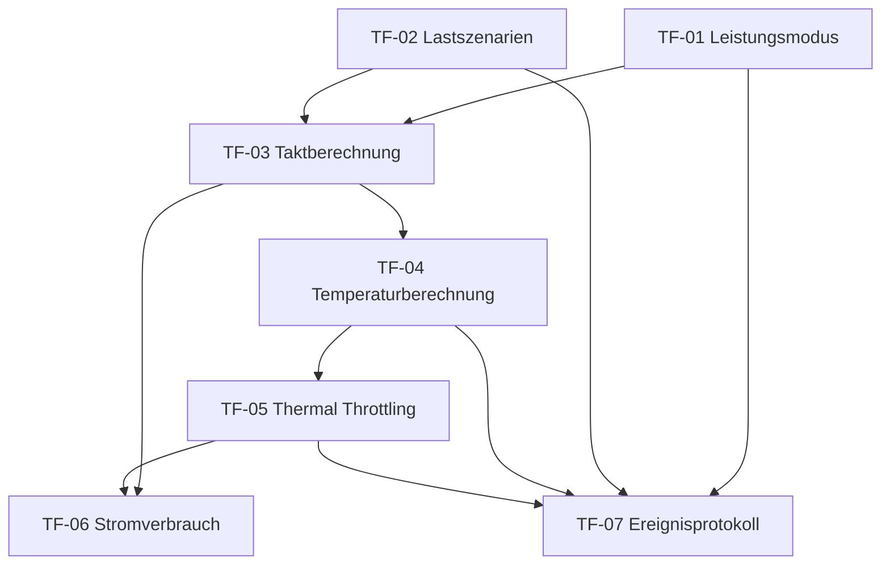

# Teilfunktionalitäten – Laptop Prozessorleistung

## 1. Ziel der Zerlegung

Dieses Dokument beschreibt die fachliche Zerlegung der Funktionalität **„Prozessorleistung eines Laptops“** in einzelne Teilfunktionalitäten.

Das Projekt wird als Software-Simulation umgesetzt. Es werden relevante Werte wie CPU-Auslastung, Taktfrequenz, Temperatur, Stromverbrauch und Thermal Throttling softwaretechnisch simuliert.

---

## 2. Systemabgrenzung

Das System simuliert die Prozessorleistung eines Laptops anhand auswählbarer Leistungsmodi und vordefinierter Nutzungsszenarien.

### Im System enthalten

- Auswahl eines Leistungsmodus
- Benutzerdefinierter Leistungsmodus
- Auswahl vordefinierter Lastszenarien
- Berechnung der CPU-Taktfrequenz
- Simulation der CPU-Temperatur
- Berücksichtigung eines Lüfter- bzw. Kühlungsfaktors
- Mehrstufiges Thermal Throttling
- Ableitung des Stromverbrauchs in Watt

### Nicht im System enthalten

- Steuerung echter Laptop-Hardware
- Zugriff auf reale CPU-Sensoren
- Änderung echter Betriebssystem-Energieprofile
- Echter Benchmark-Vergleich verschiedener Prozessoren oder Geräte
- System- oder Abnahmetest

---

## 3. Übersicht der Teilfunktionalitäten

| ID | Teilfunktionalität | Kurzbeschreibung |
|---|---|---|
| TF-01 | Leistungsmodus mit benutzerdefiniertem Modus | Verwaltung fester und benutzerdefinierter Leistungsprofile |
| TF-02 | Vordefinierte Lastszenarien | Simulation typischer Nutzungssituationen |
| TF-03 | Taktberechnung abhängig von Modus und Auslastung | Berechnung einer simulierten CPU-Taktfrequenz |
| TF-04 | Temperaturberechnung mit Lüfter-/Kühlungsfaktor | Simulation der CPU-Temperatur unter Last |
| TF-05 | Mehrstufiges Thermal Throttling | Reduzierung der Leistung bei hoher Temperatur |
| TF-06 | Stromverbrauch in Watt ableiten | Berechnung des simulierten Energieverbrauchs |
| TF-07 | Ereignisprotokoll für Moduswechsel, Warnungen und Throttling | Protokollierung relevanter Systemereignisse |

---

## 4. Detailbeschreibung der Teilfunktionalitäten

---

## TF-01 – Leistungsmodus mit benutzerdefiniertem Modus

### Beschreibung

Das System stellt mehrere Leistungsmodi zur Verfügung, mit denen das Verhalten der simulierten CPU beeinflusst wird. Neben festen Modi kann ein benutzerdefinierter Modus verwendet werden.

### Feste Leistungsmodi

| Modus | Beschreibung |
|---|---|
| Energiesparen | Reduzierte Maximalleistung und niedriger Stromverbrauch |
| Ausgeglichen | Kompromiss zwischen Leistung, Temperatur und Verbrauch |
| Höchstleistung | Maximale simulierte Leistung mit höherem Verbrauch und stärkerer Wärmeentwicklung |

### Benutzerdefinierter Modus

Im benutzerdefinierten Modus kann der Nutzer eigene Parameter festlegen, z. B.:

- maximale Leistung in Prozent
- maximal erlaubte Taktfrequenz
- bevorzugter Kühlungsfaktor
- optionale Temperaturgrenze

### Eingaben

- Auswahl eines festen Leistungsmodus
- Eingabe benutzerdefinierter Leistungsparameter

### Ausgaben

- Aktuell aktiver Leistungsmodus
- Gültige Leistungsgrenzen für weitere Berechnungen

### Zugehörige spätere Komponente

`PerformanceModeManager`

---

## TF-02 – Vordefinierte Lastszenarien

### Beschreibung

Das System bietet vordefinierte Lastszenarien, die typische Nutzungssituationen eines Laptops darstellen. Jedes Szenario erzeugt eine simulierte CPU-Auslastung.

### Mögliche Lastszenarien

| Szenario | Simulierte CPU-Auslastung | Beschreibung |
|---|---:|---|
| Idle | 5–10 % | Laptop läuft ohne aktive Belastung |
| Office | 15–30 % | Textverarbeitung, Browser, einfache Anwendungen |
| Streaming | 25–45 % | Videowiedergabe oder Online-Meeting |
| Gaming | 60–85 % | Hohe CPU- und Systemlast |
| Rendering | 85–100 % | Sehr hohe Dauerlast |

### Eingaben

- Auswahl eines Lastszenarios

### Ausgaben

- Simulierte CPU-Auslastung in Prozent
- Beschreibung des aktiven Szenarios

### Zugehörige spätere Komponente

`LoadScenarioManager`

---

## TF-03 – Taktberechnung abhängig von Modus und Auslastung

### Beschreibung

Das System berechnet eine simulierte CPU-Taktfrequenz. Die Berechnung hängt vom gewählten Leistungsmodus und der aktuellen CPU-Auslastung ab.

### Grundidee

Je höher die CPU-Auslastung und je leistungsstärker der gewählte Modus, desto höher ist die berechnete Taktfrequenz. Der benutzerdefinierte Modus kann eigene Obergrenzen vorgeben.

### Beispielhafte Taktbereiche

| Modus | Minimaler Takt | Maximaler Takt |
|---|---:|---:|
| Energiesparen | 0,8 GHz | 1,8 GHz |
| Ausgeglichen | 1,2 GHz | 3,0 GHz |
| Höchstleistung | 2,0 GHz | 4,2 GHz |
| Benutzerdefiniert | variabel | variabel |

### Eingaben

- aktiver Leistungsmodus
- simulierte CPU-Auslastung
- optionale benutzerdefinierte Grenzwerte

### Ausgaben

- berechnete CPU-Taktfrequenz in GHz

### Zugehörige spätere Komponente

`ClockCalculator`

---

## TF-04 – Temperaturberechnung mit Lüfter-/Kühlungsfaktor

### Beschreibung

Das System simuliert die CPU-Temperatur anhand der aktuellen Auslastung, Taktfrequenz und eines Kühlungsfaktors.

### Einflussfaktoren

| Einflussfaktor | Wirkung |
|---|---|
| CPU-Auslastung | Höhere Auslastung erhöht die Temperatur |
| Taktfrequenz | Höherer Takt erhöht die Temperatur |
| Kühlungsfaktor | Bessere Kühlung senkt die Temperatur |
| Leistungsmodus | Leistungsstärkere Modi erzeugen tendenziell mehr Wärme |

### Beispielhafte Kühlungsfaktoren

| Kühlungszustand | Kühlungsfaktor | Beschreibung |
|---|---:|---|
| Schwach | 0,7 | Lüfter arbeitet schlecht oder Kühlung ist eingeschränkt |
| Normal | 1,0 | Normale Laptop-Kühlung |
| Stark | 1,3 | Gute Kühlung bzw. hohe Lüfterleistung |

### Eingaben

- CPU-Auslastung
- berechnete Taktfrequenz
- Kühlungsfaktor

### Ausgaben

- simulierte CPU-Temperatur in °C

### Zugehörige spätere Komponente

`TemperatureSimulator`

---

## TF-05 – Mehrstufiges Thermal Throttling

### Beschreibung

Das System erkennt zu hohe CPU-Temperaturen und reduziert die Prozessorleistung stufenweise. Dadurch wird simuliert, dass ein Laptop seine Leistung zum Schutz der Hardware verringert.

### Throttling-Stufen

| Stufe | Temperaturbereich | Verhalten |
|---|---:|---|
| Normalbetrieb | unter 75 °C | Keine Einschränkung |
| Warnung | ab 75 °C | Warnmeldung wird erzeugt |
| Reduzierte Leistung | ab 85 °C | CPU-Leistung wird reduziert |
| Kritischer Zustand | ab 95 °C | starke Leistungsreduzierung und kritische Warnung |

### Eingaben

- simulierte CPU-Temperatur
- aktuelle Taktfrequenz
- aktueller Leistungsmodus

### Ausgaben

- Throttling-Stufe
- angepasste maximale Leistung
- Warn- oder Kritischmeldung

### Zugehörige spätere Komponente

`ThermalThrottlingController`

---

## TF-06 – Stromverbrauch in Watt ableiten

### Beschreibung

Das System berechnet einen simulierten Stromverbrauch in Watt. Der Verbrauch wird aus der aktuellen Prozessorleistung, dem Leistungsmodus und der Taktfrequenz abgeleitet.

### Grundidee

Eine höhere Taktfrequenz und eine höhere CPU-Auslastung führen zu einem höheren Stromverbrauch. Energiesparmodi begrenzen den Verbrauch, während Höchstleistung einen höheren Verbrauch erlaubt.

### Beispielhafte Verbrauchsbereiche

| Zustand | Verbrauch |
|---|---:|
| Idle / geringe Last | 5–10 W |
| Office / normale Last | 10–25 W |
| Gaming / hohe Last | 30–50 W |
| Rendering / maximale Last | 50–65 W |

### Eingaben

- Leistungsmodus
- CPU-Auslastung
- berechnete Taktfrequenz
- ggf. Throttling-Stufe

### Ausgaben

- berechneter Stromverbrauch in Watt

### Zugehörige spätere Komponente

`PowerConsumptionCalculator`

---

## TF-07 – Ereignisprotokoll für Moduswechsel, Warnungen und Throttling

### Beschreibung

Das System protokolliert relevante Ereignisse während der Simulation. Dadurch wird nachvollziehbar, wann sich der Zustand des Systems verändert hat.

### Zu protokollierende Ereignisse

| Ereignisart | Beispiel |
|---|---|
| Moduswechsel | Wechsel von Ausgeglichen zu Höchstleistung |
| Lastszenario geändert | Wechsel von Office zu Gaming |
| Temperaturwarnung | Temperatur überschreitet 75 °C |
| Thermal Throttling aktiviert | Leistung wird ab 85 °C reduziert |
| Kritischer Zustand erreicht | Temperatur überschreitet 95 °C |

### Mögliche Log-Daten

- Zeitpunkt des Ereignisses
- Ereignistyp
- Beschreibung
- betroffener Leistungsmodus
- aktuelle Temperatur
- aktuelle CPU-Auslastung
- aktuelle Taktfrequenz

### Eingaben

- Systemereignisse aus anderen Komponenten

### Ausgaben

- Ereignisprotokoll als Konsolenausgabe oder Datei
- nachvollziehbare Historie der Simulation

### Zugehörige spätere Komponente

`EventLogger`

---

## 5. Zusammenhang der Teilfunktionalitäten

Die Teilfunktionalitäten bauen logisch aufeinander auf:

---

## 6. Vorläufige Iterationszuordnung

| Iteration | Teilfunktionalitäten | Ziel der Iteration |
|---:|---|---|
| Iteration 1 | TF-01, TF-02, TF-03 | Auswahl von Leistungsmodus und Lastszenario sowie Berechnung der Taktfrequenz |
| Iteration 2 | TF-04, TF-06, erste Version TF-07 | Simulation von Temperatur und Stromverbrauch sowie einfache Ereignisprotokollierung |
| Iteration 3 | TF-05, vollständige TF-07 | Mehrstufiges Thermal Throttling und vollständiges Ereignisprotokoll |

---

## 7. Vorläufige Komponentenableitung

| Teilfunktionalität | Mögliche Komponente |
|---|---|
| TF-01 Leistungsmodus mit benutzerdefiniertem Modus | `PerformanceModeManager` |
| TF-02 Vordefinierte Lastszenarien | `LoadScenarioManager` |
| TF-03 Taktberechnung | `ClockCalculator` |
| TF-04 Temperaturberechnung | `TemperatureSimulator` |
| TF-05 Thermal Throttling | `ThermalThrottlingController` |
| TF-06 Stromverbrauch | `PowerConsumptionCalculator` |
| TF-07 Ereignisprotokoll | `EventLogger` |

---

## 8. Vorläufige Gesamtbeschreibung

Das Softwaresystem simuliert die Prozessorleistung eines Laptops. Der Nutzer kann einen Leistungsmodus und ein vordefiniertes Lastszenario auswählen. Aus diesen Eingaben berechnet das System eine simulierte CPU-Auslastung und eine daraus resultierende Taktfrequenz. Anschließend werden CPU-Temperatur und Stromverbrauch berechnet.

Bei zu hoher Temperatur wird die Prozessorleistung durch ein mehrstufiges Thermal Throttling reduziert. Relevante Ereignisse wie Moduswechsel, Lastwechsel, Temperaturwarnungen und Drosselungsmaßnahmen werden in einem Ereignisprotokoll festgehalten.