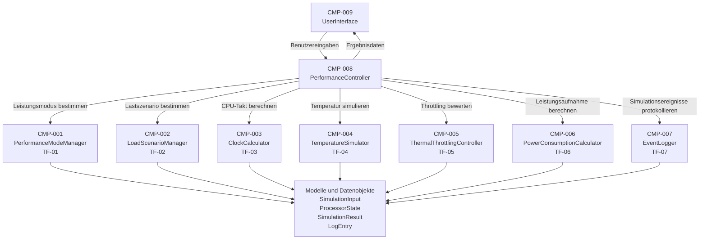

# Komponentenuebersicht

**Version:** 0.2  

---

## 1. Zweck dieses Dokuments

Dieses Dokument beschreibt die Komponenten des **Laptop-Prozessorleistungsmoduls** auf Architektur-Ebene.

Es konkretisiert die im Systemkontext und im Architekturziel festgelegte modulare Schichtenarchitektur und beschreibt:

- welche Hauptkomponenten das System besitzt,
- welche Verantwortung jede Komponente übernimmt,
- welche Eingaben und Ausgaben jede Komponente verarbeitet,
- welcher Teilfunktionalität und Iteration die Komponente zugeordnet ist,
- welche Komponenten miteinander kommunizieren,
- welche Datenmodelle für die Komponenten erforderlich sind,
- wie die Komponenten später in Code, Tests und Traceability Matrix nachverfolgbar bleiben.

---

## 2. Einordnung in die Architektur

Das Laptop-Prozessorleistungsmodul verwendet eine modulare Schichtenarchitektur.

Die Komponenten werden folgenden Schichten zugeordnet:

```text
Benutzerschnittstelle
        ↓
Anwendungssteuerung
        ↓
Fachlogik / Services
        ↓
Modelle und Datenobjekte
        ↓
Protokollierung / Nachweisführung
```

---

## 3. Komponentenübersicht

| Komponenten-ID | Komponente | Schicht | Zugehörigkeit | Iteration |
|---|---|---|---|---:|
| CMP-001 | `PerformanceModeManager` | Fachlogik / Services | TF-01 Leistungsmodus | 1 |
| CMP-002 | `LoadScenarioManager` | Fachlogik / Services | TF-02 Lastszenario | 1 |
| CMP-003 | `ClockCalculator` | Fachlogik / Services | TF-03 Taktberechnung | 1 |
| CMP-004 | `TemperatureSimulator` | Fachlogik / Services | TF-04 Temperatursimulation | 2 |
| CMP-005 | `ThermalThrottlingController` | Fachlogik / Services | TF-05 Thermal Throttling | 3 |
| CMP-006 | `PowerConsumptionCalculator` | Fachlogik / Services | TF-06 Leistungsaufnahme | 2–3 |
| CMP-007 | `EventLogger` | Protokollierung / Nachweisführung | TF-07 Protokollierung | 2–3 |
| CMP-008 | `PerformanceController` | Anwendungssteuerung | Übergreifende Ablaufsteuerung | 1–3 |
| CMP-009 | `UserInterface` | Benutzerschnittstelle | Eingabe und Ausgabe | 1–3 |

---

## 4. Architekturdiagramm der Komponenten



---

## 5. Detaillierte Komponententabelle

| Komponenten-ID | Komponente | Aufgabe | Eingabe | Ausgabe | Zugehörige Requirements | Testfokus |
|---|---|---|---|---|---|---|
| CMP-001 | `PerformanceModeManager` | Stellt verfügbare Leistungsmodi bereit und bewertet den ausgewählten Modus. | Auswahl des Leistungsmodus | `PerformanceMode` | REQ-F-001, REQ-F-002, REQ-F-003, REQ-F-004 | gültige Modi, ungültige Modi, Moduswerte |
| CMP-002 | `LoadScenarioManager` | Stellt verfügbare Lastszenarien bereit und bewertet das ausgewählte Szenario. | Auswahl des Lastszenarios | `LoadScenario` | REQ-F-005, REQ-F-006, REQ-F-007, REQ-F-008 | gültige Szenarien, ungültige Szenarien, Lastfaktoren |
| CMP-003 | `ClockCalculator` | Berechnet oder bewertet die simulierte CPU-Taktfrequenz anhand von Modus, Lastszenario und CPU-Auslastung. | `PerformanceMode`, `LoadScenario`, CPU-Auslastung | berechnete CPU-Taktfrequenz | REQ-F-009, REQ-F-010, REQ-F-011, REQ-F-012 | deterministische Taktberechnung, Grenzwerte, Kombinationen aus Modus und Last |
| CMP-004 | `TemperatureSimulator` | Simuliert die CPU-Temperatur anhand des aktuellen Prozessorzustands. | CPU-Auslastung, CPU-Taktfrequenz, optional Leistungsmodus | simulierte CPU-Temperatur | REQ-F-013, REQ-F-014, REQ-F-015, REQ-F-016 | Temperaturberechnung, Grenzwerte, reproduzierbare Ergebnisse |
| CMP-005 | `ThermalThrottlingController` | Bewertet, ob Thermal Throttling aktiv ist, und leitet daraus eine reduzierte Leistung ab. | CPU-Temperatur, Schwellenwert, CPU-Taktfrequenz | Throttling-Status, ggf. reduzierter Takt | REQ-F-024, REQ-F-025, REQ-F-026, REQ-F-027, REQ-F-028, REQ-F-029 | Schwellenwert unterschritten, erreicht, überschritten |
| CMP-006 | `PowerConsumptionCalculator` | Berechnet oder bewertet die Leistungsaufnahme des Prozessors. | CPU-Auslastung, CPU-Taktfrequenz, Temperatur, Modus | Leistungsaufnahme in Watt | REQ-F-017, REQ-F-018, REQ-F-019 | Verbrauchsberechnung, Plausibilitätsgrenzen, Modusabhängigkeit |
| CMP-007 | `EventLogger` | Protokolliert Eingaben, Verarbeitungsschritte und Ergebniswerte. | Simulationsereignisse, Ergebnisdaten | `LogEntry` oder Protokollausgabe | REQ-F-020, REQ-F-021, REQ-F-022, REQ-F-023, REQ-F-030, REQ-F-031, REQ-F-032, REQ-F-033 | vollständige Logeinträge, Reihenfolge, Reproduzierbarkeit |
| CMP-008 | `PerformanceController` | Koordiniert den vollständigen Simulationsablauf und verbindet Benutzerschnittstelle, Fachlogik und Ergebnisobjekt. | `SimulationInput` | `SimulationResult` | REQ-F-012, REQ-F-019, REQ-F-029, REQ-F-031, REQ-F-033, REQ-NF-001, REQ-NF-003 | Ablaufreihenfolge, Integration der Fachkomponenten |
| CMP-009 | `UserInterface` | Nimmt Eingaben entgegen und zeigt Simulationsergebnisse an. | Benutzereingaben | Ergebnisanzeige | REQ-F-008, REQ-F-011, REQ-F-016, REQ-F-018, REQ-F-028, REQ-F-032, REQ-NF-006 | Eingabevalidierung, Ergebnisdarstellung, Fehlerausgabe |

---

## 6. Komponentenverantwortlichkeiten

### 6.1 `UserInterface`

Die Komponente `UserInterface` ist für die Interaktion mit dem Benutzer zuständig. Sie nimmt Eingaben entgegen und zeigt Ergebnisse an. Sie enthält keine fachliche Berechnungslogik.

**Verantwortlichkeiten:**

- Leistungsmodus vom Benutzer aufnehmen,
- Lastszenario vom Benutzer aufnehmen,
- leistungsrelevante Eingabewerte aufnehmen,
- Eingaben an den `PerformanceController` übergeben,
- Ergebniswerte aus `SimulationResult` anzeigen,
- Fehlermeldungen verständlich ausgeben.


---

### 6.2 `PerformanceController`

Die Komponente `PerformanceController` koordiniert den vollständigen Simulationsablauf. Sie ruft die benötigten Fachkomponenten in definierter Reihenfolge auf und erzeugt daraus ein strukturiertes Simulationsergebnis.

**Verantwortlichkeiten:**

- Eingabedaten aus der Benutzerschnittstelle übernehmen,
- Ablauf der Simulation steuern,
- Fachkomponenten in passender Reihenfolge aufrufen,
- Zwischenergebnisse in Datenobjekten sammeln,
- vollständiges `SimulationResult` erzeugen,
- Ereignisse an den `EventLogger` übergeben.

---

### 6.3 `PerformanceModeManager`

Die Komponente `PerformanceModeManager` verwaltet die verfügbaren Leistungsmodi des Prozessors.

**Typische Modi:**

- Energiesparmodus,
- Ausbalancierter Modus,
- Leistungsmodus.

**Verantwortlichkeiten:**

- verfügbare Leistungsmodi bereitstellen,
- Benutzerauswahl validieren,
- ausgewählten Modus als `PerformanceMode` bereitstellen,
- modusabhängige Faktoren für spätere Berechnungen liefern.

---

### 6.4 `LoadScenarioManager`

Die Komponente `LoadScenarioManager` verwaltet die verfügbaren Lastszenarien.

**Typische Lastszenarien:**

- Leerlauf,
- Office-Nutzung,
- Streaming,
- Gaming,
- Volllast.

**Verantwortlichkeiten:**

- verfügbare Lastszenarien bereitstellen,
- Benutzerauswahl validieren,
- ausgewähltes Szenario als `LoadScenario` bereitstellen,
- szenarioabhängige Lastfaktoren für spätere Berechnungen liefern.

---

### 6.5 `ClockCalculator`

Die Komponente `ClockCalculator` berechnet oder bewertet die CPU-Taktfrequenz.

**Verantwortlichkeiten:**

- CPU-Taktfrequenz anhand von Leistungsmodus, Lastszenario und Auslastung bestimmen,
- minimale und maximale Taktgrenzen beachten,
- deterministische Ergebnisse erzeugen,
- berechneten Takt als Teil des `ProcessorState` bereitstellen.

---

### 6.6 `TemperatureSimulator`

Die Komponente `TemperatureSimulator` simuliert die CPU-Temperatur.

**Verantwortlichkeiten:**

- Temperatur aus Prozessorzustand ableiten,
- Last- und Taktabhängigkeit berücksichtigen,
- Temperaturwert für die Throttling-Bewertung bereitstellen,
- reproduzierbare Simulationsergebnisse erzeugen.

---

### 6.7 `ThermalThrottlingController`

Die Komponente `ThermalThrottlingController` bewertet, ob Thermal Throttling vorliegt.

**Verantwortlichkeiten:**

- CPU-Temperatur mit einem definierten Schwellenwert vergleichen,
- Throttling-Status bestimmen,
- bei aktivem Throttling einen reduzierten Taktwert bereitstellen,
- Throttling-Information im Ergebnisobjekt verfügbar machen.

---

### 6.8 `PowerConsumptionCalculator`

Die Komponente `PowerConsumptionCalculator` berechnet oder bewertet die Leistungsaufnahme des Prozessors.

**Verantwortlichkeiten:**

- Leistungsaufnahme anhand von Auslastung, Taktfrequenz, Temperatur und Leistungsmodus bestimmen,
- Verbrauchswert als Ergebniswert bereitstellen,
- Plausibilitätsgrenzen einhalten.

---

### 6.9 `EventLogger`

Die Komponente `EventLogger` protokolliert relevante Simulationsdaten.

**Verantwortlichkeiten:**

- Eingabewerte protokollieren,
- aufgerufene Verarbeitungsschritte protokollieren,
- Ergebniswerte protokollieren,
- Logeinträge strukturiert bereitstellen.


---

## 7. Datenmodelle und Datenobjekte

Die folgenden Datenmodelle werden für die Kommunikation zwischen Komponenten benötigt. Sie werden im Feindesign weiter konkretisiert.

| Datenmodell | Zweck | Typische Inhalte |
|---|---|---|
| `SimulationInput` | Bündelt alle Eingaben für einen Simulationslauf. | Leistungsmodus, Lastszenario, CPU-Auslastung, optional Startwerte |
| `PerformanceMode` | Repräsentiert den ausgewählten Leistungsmodus. | Modusname, Taktfaktor, Verbrauchsfaktor |
| `LoadScenario` | Repräsentiert das ausgewählte Lastszenario. | Szenarioname, Lastfaktor, Standardauslastung |
| `ProcessorState` | Repräsentiert den aktuellen Prozessorzustand. | CPU-Auslastung, Taktfrequenz, Temperatur, Throttling-Status, Leistungsaufnahme |
| `SimulationResult` | Bündelt alle Ergebniswerte eines Simulationslaufs. | Endzustand, Ergebnisbewertung, Hinweise, Logreferenz |
| `LogEntry` | Repräsentiert einen Protokolleintrag. | Zeitpunkt, Ereignistyp, Nachricht, relevante Werte |

---

## 8. Schnittstellen auf Komponentenebene

| Von Komponente | Zu Komponente | Zweck der Kommunikation | Übergebene Daten |
|---|---|---|---|
| `UserInterface` | `PerformanceController` | Start eines Simulationslaufs | `SimulationInput` |
| `PerformanceController` | `PerformanceModeManager` | Leistungsmodus validieren und abrufen | Moduskennung |
| `PerformanceController` | `LoadScenarioManager` | Lastszenario validieren und abrufen | Szenariokennung |
| `PerformanceController` | `ClockCalculator` | CPU-Taktfrequenz berechnen | `PerformanceMode`, `LoadScenario`, CPU-Auslastung |
| `PerformanceController` | `TemperatureSimulator` | CPU-Temperatur simulieren | `ProcessorState` |
| `PerformanceController` | `ThermalThrottlingController` | Thermal Throttling bewerten | `ProcessorState`, Temperaturwert |
| `PerformanceController` | `PowerConsumptionCalculator` | Leistungsaufnahme berechnen | `ProcessorState`, `PerformanceMode` |
| `PerformanceController` | `EventLogger` | Simulationsereignisse protokollieren | Eingaben, Zwischenergebnisse, Endergebnis |
| `PerformanceController` | `UserInterface` | Ergebnis zurückgeben | `SimulationResult` |

---


## 9. Iterationsbezug der Komponenten

| Iteration | Neu entstehende oder relevante Komponenten | Ziel der Iteration | Ergebnis nach Iteration |
|---:|---|---|---|
| 1 | `UserInterface`, `PerformanceController`, `PerformanceModeManager`, `LoadScenarioManager`, `ClockCalculator`, Grunddatenmodelle | Leistungsmodus, Lastszenario und CPU-Takt berechnen | Lauffähige Software mit Eingabe und Taktergebnis |
| 2 | `TemperatureSimulator`, `ThermalThrottlingController`, Erweiterung von `ProcessorState` und `SimulationResult` | Temperatur und Thermal Throttling ergänzen | Lauffähige Software mit Temperatur- und Throttling-Ergebnis |
| 3 | `PowerConsumptionCalculator`, `EventLogger`, Erweiterung der Ergebnis- und Logdaten | Leistungsaufnahme und Protokollierung ergänzen | Lauffähige Software mit vollständigem Ergebnis und Protokollausgabe |

---

## 10. Traceability-Vorbereitung

Die Komponenten sind so gewählt, dass jedes funktionale Requirement einer fachlichen Komponente zugeordnet werden kann.

| Teilfunktionalität | Hauptkomponente | Erwartete Code-Zuordnung | Erwartete Test-Zuordnung |
|---|---|---|---|
| TF-01 Leistungsmodus | `PerformanceModeManager` | Datei/Klasse für Leistungsmodi | Modultests für gültige und ungültige Modi |
| TF-02 Lastszenario | `LoadScenarioManager` | Datei/Klasse für Lastszenarien | Modultests für Szenarioauswahl und Lastfaktoren |
| TF-03 Taktberechnung | `ClockCalculator` | Datei/Klasse für Taktberechnung | Modultests für Taktformel und Grenzwerte |
| TF-04 Temperatursimulation | `TemperatureSimulator` | Datei/Klasse für Temperatursimulation | Modultests für Temperaturwerte und Grenzfälle |
| TF-05 Thermal Throttling | `ThermalThrottlingController` | Datei/Klasse für Throttling-Bewertung | Modultests für Schwellenwertverhalten |
| TF-06 Leistungsaufnahme | `PowerConsumptionCalculator` | Datei/Klasse für Leistungsaufnahme | Modultests für Verbrauchswerte und Plausibilität |
| TF-07 Protokollierung | `EventLogger` | Datei/Klasse für Logging | Modultests für Logeinträge und Vollständigkeit |
| Übergreifend | `PerformanceController` | Datei/Klasse für Ablaufsteuerung | Integrationstests für vollständigen Ablauf |
| Bedienung/Ausgabe | `UserInterface` | Datei/Klasse für UI oder CLI | Tests für Eingabe, Ausgabe und Fehlermeldungen |

Die konkreten Code-Dateien und Testfall-IDs werden ergänzt, sobald Implementierung und Testfälle angelegt sind.

---

## 11. Architekturregeln für Komponenten

| Regel-ID | Regel |
|---|---|
| KR-001 | Jede Fachkomponente übernimmt genau eine fachliche Hauptaufgabe. |
| KR-002 | Die Benutzerschnittstelle ruft keine Fachkomponente direkt auf, sondern kommuniziert mit dem `PerformanceController`. |
| KR-003 | Der `PerformanceController` enthält Ablaufsteuerung, aber keine Detailformeln für Takt, Temperatur, Throttling oder Leistungsaufnahme. |
| KR-004 | Fachkomponenten kommunizieren über definierte Datenobjekte. |
| KR-005 | Datenmodelle enthalten keine komplexe Fachlogik. |
| KR-006 | Protokollierung darf Simulationsergebnisse nicht verändern. |
| KR-007 | Jede Komponente muss separat testbar bleiben. |
| KR-008 | Jede Komponente muss in der Traceability Matrix einem Requirement und mindestens einem Testfall zugeordnet werden können. |
| KR-009 | Erweiterungen in späteren Iterationen dürfen bestehende Komponenten nicht mit fremden Verantwortlichkeiten überladen. |
